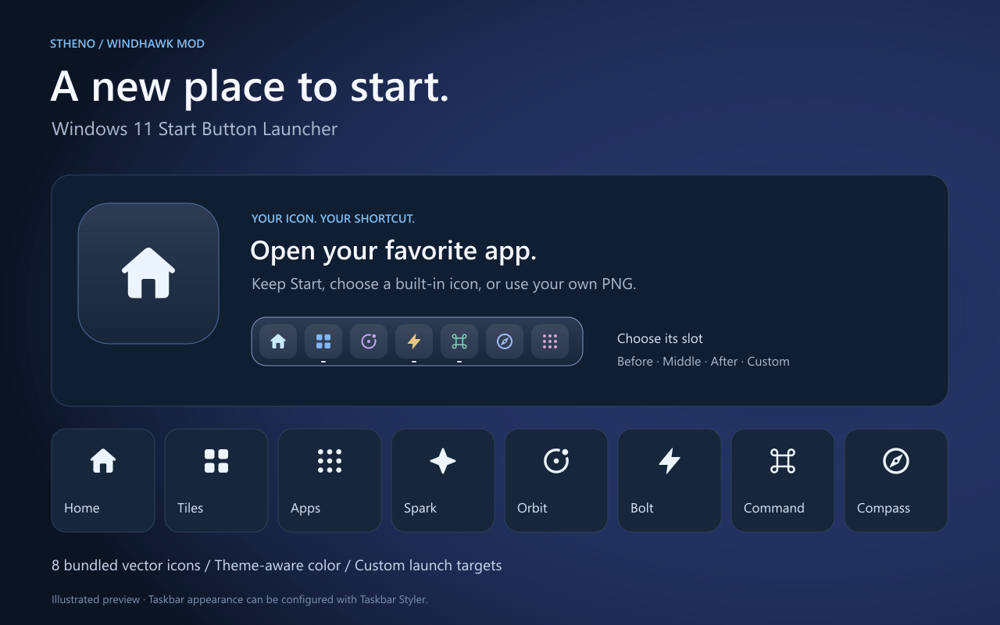
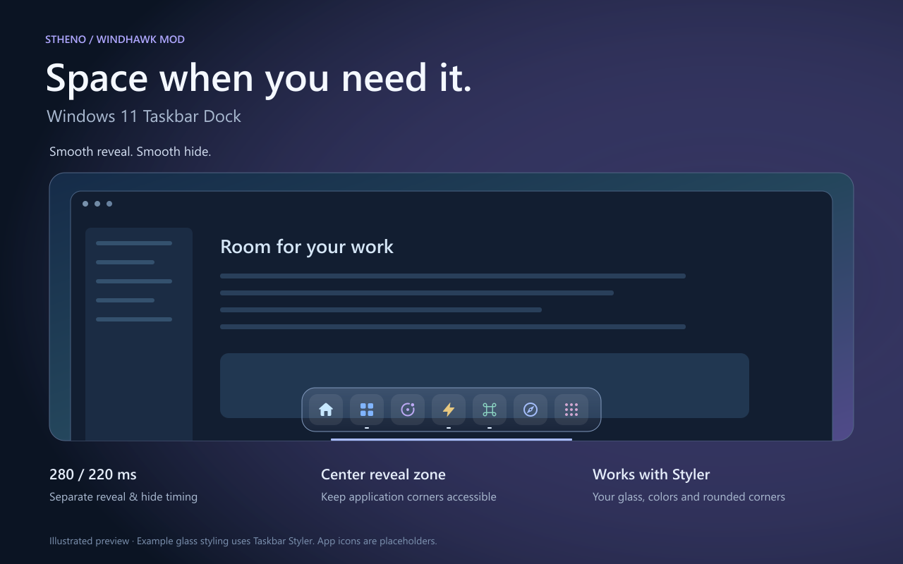
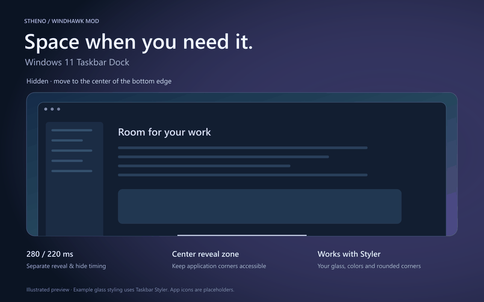

# Stheno's Windhawk mod previews

Original code-drawn artwork for Windows 11 Start Button Launcher and Windows 11
Taskbar Dock. These are labeled illustrations, not desktop recordings. Generic
app glyphs are placeholders. Example glass styling is configured with Taskbar Styler.

## Windows 11 Start Button Launcher

## Windows 11 Taskbar Dock

By Stheno (https://github.com/sth3no), with ChatGPT assistance.
Artwork and included SVG sources: GPL-3.0, see LICENSE.
